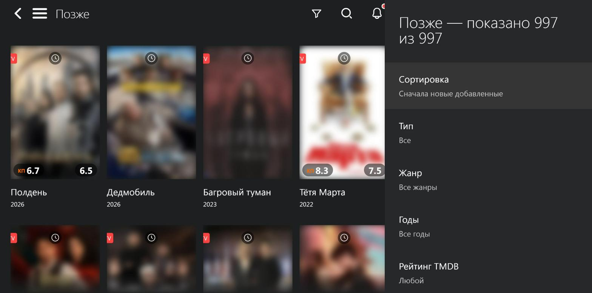
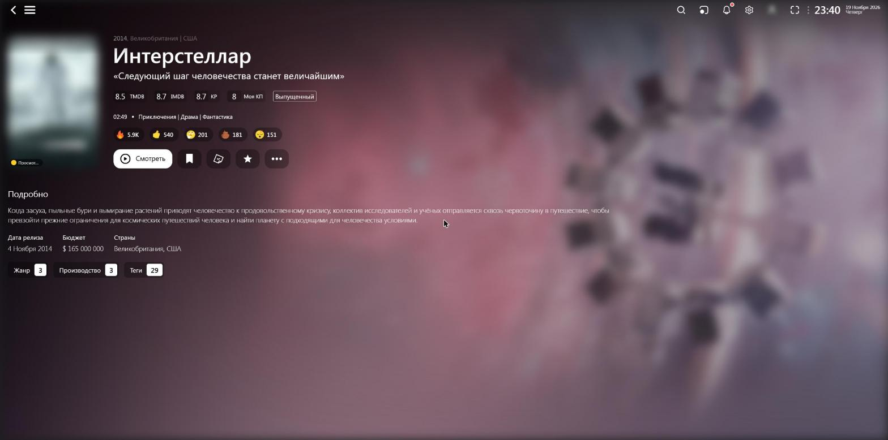
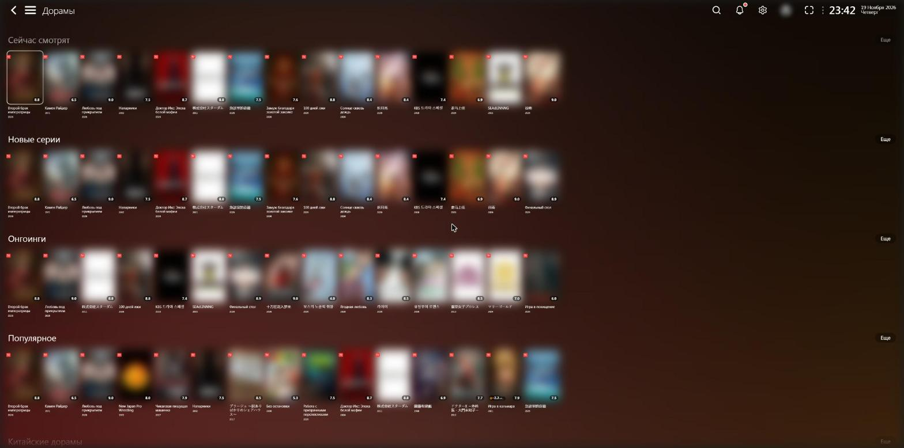

# Плагины для Lampa

Плагины и доработки, которыми я пользуюсь в своей Lampa с сервером [Lampac NextGen](https://github.com/lampac-nextgen/lampac).

| Что | Для чего |
|---|---|
| [`fav-sort.js`](#сортировка-закладок--fav-sortjs) | Сортировка и фильтры закладок, рейтинг Кинопоиска на постерах |
| [`card-size.js`](#размер-карточек--card-sizejs) | Размер карточек и масштаб интерфейса на больших мониторах |
| [`kp-vote`](kp-vote/) | Ваши оценки Кинопоиска в карточке и оценка 1–10 прямо из Lampa |
| [`favorite-plus`](favorite-plus/) | Патч Favorite Plus: общие списки для всех профилей без потери правок |
| [`lampac`](lampac/) | Раздел «Дорамы» (корейские, китайские, японские), очистка старых плагинов с устройств, уведомления о сериях в Telegram, сборка Android-приложения |
| [`myshows-auth-proxy`](myshows-auth-proxy/) | Свой прокси входа для плагина MyShows |


## Сортировка закладок — `fav-sort.js`

Сортировка и фильтры для закладок Lampa 3.x: «Позже», «Просмотрено», «Закладки», «Нравится», «Смотрю» и других категорий.

**Установка:** Lampa → «Настройки» → «Расширения» → «Добавить плагин», адрес:

```
https://msbbol.github.io/lampa-plugins/fav-sort.js
```

После перезапуска Lampa на страницах закладок в шапке появится кнопка-воронка. Если выбраны не штатные настройки, она подсвечивается жёлтым.




<sub>Постеры на скриншотах размыты.</sub>

### Что умеет

**Сортировка:**
- по дате добавления (сначала новые или сначала старые);
- по году выхода;
- по названию;
- по рейтингу TMDB;
- по рейтингу Кинопоиска (нужен сервер, см. ниже).

Рейтинги взвешенные: у фильма с тремя оценками «10» нет преимущества перед фильмом с рейтингом 8.5 по десяткам тысяч оценок.

**Фильтры:**
- **тип:** фильмы, сериалы, мультфильмы (вместе с мультсериалами и аниме), ТВ-шоу (реалити, ток-шоу, новости);
- жанр;
- десятилетие;
- минимальный рейтинг TMDB;
- минимальный рейтинг Кинопоиска.

У каждого пункта в меню показано, сколько карточек под него подходит.

**Как устроено:**
- Настройки хранятся на устройстве, отдельно для каждой категории закладок.
- Пункт «Сбросить» возвращает штатный порядок.
- Плагин не меняет сами закладки: он только по-другому отдаёт их на экран. Без выбранных настроек Lampa работает как обычно.
- Код на ES5, поэтому плагин работает на старых телевизорах Tizen и webOS.

### Рейтинг Кинопоиска (необязательно)

У Lampa нет рейтингов Кинопоиска для всего списка закладок сразу, поэтому их собирает отдельный скрипт на сервере. Без него функции Кинопоиска просто скрыты, остальное работает.

Если плагин подключён с GitHub по ссылке выше, адрес файла с рейтингами передаётся параметром `kp`:

```
https://msbbol.github.io/lampa-plugins/fav-sort.js?kp=http://192.168.1.10:9118/kp/ratings.json
```

Если плагин отдаёт ваш собственный Lampac, параметр не нужен: плагин сам ищет `kp/ratings.json` рядом с собой.

Когда рейтинги есть, они появляются:
- в сортировке;
- в фильтре;
- значком «КП» в левом нижнем углу постеров (штатный рейтинг TMDB остаётся справа).

#### Сборщик `kp-ratings.py` (для владельцев Lampac)

Скрипт берёт закладки из Lampac и запрашивает рейтинги в [API ПоискКино](https://poiskkino.dev) (бывший kinopoisk.dev). Бесплатного ключа хватает. Сначала он ищет фильм по TMDB id. Если не нашлось, берёт id Кинопоиска из Lampac `/externalids`. Тип (фильм или сериал) и год сверяются, чтобы не подхватить чужой рейтинг.

Чтобы не выходить за лимит бесплатного тарифа, скрипт делает не больше 40 запросов за запуск и 150 в сутки. Найденные рейтинги обновляются раз в месяц.

Установка (пример для Lampac в Docker в `/opt/lampac`):

1. Получите ключ на poiskkino.dev и сохраните его:

   ```sh
   install -m 600 /dev/null /opt/lampac/config/kp-api.key
   nano /opt/lampac/config/kp-api.key        # вставить ключ одной строкой
   ```

2. Положите `kp-ratings.py` в `/opt/lampac/` и подключите папку с результатом в `docker-compose.yaml`:

   ```yaml
   volumes:
     - ./kp:/lampac/wwwroot/kp:ro
   ```

3. Запускайте раз в час по cron (`/etc/cron.d/kp-ratings`):

   ```
   23 * * * * root LAMPAC_URL=http://127.0.0.1:9118 LAMPAC_ACCOUNT=you@example.com /usr/bin/python3 /opt/lampac/kp-ratings.py >> /var/log/kp-ratings.log 2>&1
   ```

   `LAMPAC_ACCOUNT` — email аккаунта Lampac (accsdb), чьи закладки берутся. Если accsdb выключен, оставьте пустым.

4. Чтобы плагин подключался всем клиентам автоматически, добавьте его в `init.conf`:

   ```json
   "LampaWeb": {
     "customPlugins": [
       { "name": "Сортировка закладок", "url": "https://msbbol.github.io/lampa-plugins/fav-sort.js?kp={localhost}/kp/ratings.json" }
     ]
   }
   ```

Формат `ratings.json`: `{"updated": <unix>, "r": {"movie:278": [рейтинг, голосов, id_кинопоиска], "tv:1396": [...]}}`.

Другие переменные окружения:

| Переменная | Значение по умолчанию |
|---|---|
| `KP_KEY_FILE` | `/opt/lampac/config/kp-api.key` |
| `KP_STATE` | `/opt/lampac/kp-state.json` |
| `KP_OUT` | `/opt/lampac/kp/ratings.json` |
| `KP_MAX_REQ_RUN` | `40` |
| `KP_MAX_REQ_DAY` | `150` |

## Размер карточек — `card-size.js`

Для больших мониторов (4K, 27–32"). Lampa подгоняет интерфейс под ширину окна, поэтому на большом экране карточки огромные, а в сетке закладок и категорий всегда 6 колонок. Плагин добавляет в «Настройки» → «Интерфейс» два пункта:

- **Размер карточек:** от 6 до 12 в ряду. Карточки в лентах на главной уменьшаются в той же пропорции, а лента сразу заполняется на всю ширину.
- **Масштаб интерфейса:** общий размер шапки, меню и текста, от 50 до 100 %.

Настройки хранятся на устройстве, поэтому на ПК и на телевизоре можно выставить разные. На телефонах (экран уже 768 px) размер карточек не меняется.

**Установка:** Lampa → «Настройки» → «Расширения» → «Добавить плагин», адрес:

```
https://msbbol.github.io/lampa-plugins/card-size.js
```

## Оценки Кинопоиска — `kp-vote`

Значок «Моя КП» с вашей оценкой в карточке фильма и кнопка «Оценить» (1–10): оценка сразу уходит в ваш аккаунт Кинопоиска. Нужен небольшой сервис на своём сервере. Подробно — в [`kp-vote/`](kp-vote/).



## Общие списки — патч Favorite Plus

С плагином профилей списки [Favorite Plus](https://anclaver.github.io/Lampa/) общие для всех профилей. Патч убирает их стирание при смене профиля и сливает правки с разных устройств вместо перезаписи. Подробно — в [`favorite-plus/`](favorite-plus/).

## Доработки Lampac

Раздел «Дорамы» с корейскими, китайскими и японскими дорамами, удаление старых плагинов с устройств, включение уведомлений о сериях в Telegram и сборка Android-приложения под свой сервер. Подробно — в [`lampac/`](lampac/).



<sub>Постеры на скриншотах размыты.</sub>

## Лицензия

MIT, кроме [`lampac/dorama.js`](lampac/dorama.js): это изменённый файл Lampac NextGen, он под AGPL-3.0, как оригинал. Патч в [`favorite-plus/`](favorite-plus/) содержит только мои изменения к плагину anclaver.
