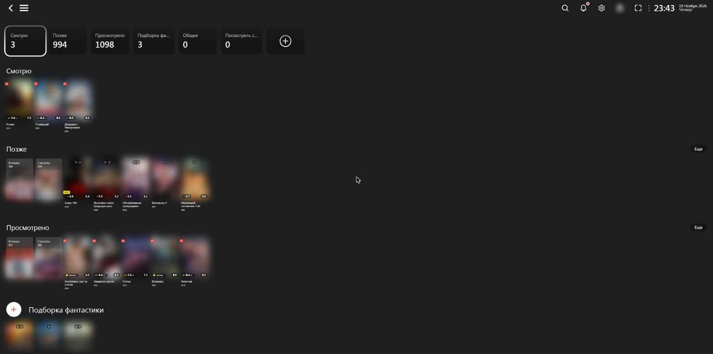

# Favorite Plus: общие списки без потерь — патч

[Favorite Plus](https://anclaver.github.io/Lampa/) (автор — anclaver) добавляет в Lampa свои списки закладок. Он хранит их в хранилище Lampac на весь аккаунт, поэтому с плагином профилей [profiles.js](https://github.com/levende/lampa-plugins) эти списки получаются **общими для всех профилей**. Так у меня работают «Общее» и «Посмотреть с Маратом», а «Позже» и «Просмотрено» у каждого свои.



<sub>Постеры на скриншоте размыты.</sub>

В исходной версии 5.2.10 при такой схеме есть две проблемы, этот патч их исправляет.

## Что исправляет патч

1. **Списки стирались при смене профиля.** Плагин очищал свои данные на устройстве, когда profiles.js переключал профиль, и не загружал их заново до перезапуска Lampa. Если в этот момент добавить фильм в свой список, общий файл на сервере перезаписывался почти пустым. Патч убирает это стирание: списки общие на аккаунт, стирать их незачем.

2. **Одновременные правки затирали друг друга.** Плагин загружал списки только при запуске Lampa, а при сохранении отправлял на сервер весь файл целиком. Устройство, открытое раньше, при следующей правке стирало изменения, сделанные на других устройствах. Патч заменяет синхронизацию трёхсторонним слиянием:
   - плагин помнит последнюю версию с сервера, которую видел (`favorite_plus_base`);
   - перед записью берёт свежую версию с сервера и накладывает на неё только свои изменения: добавления и удаления карточек, создание, переименование и удаление списков;
   - если два устройства одновременно создали список с одним названием, он объединяется;
   - изменения с других устройств подтягиваются сразу: по событию Lampac `storage` через WebSocket, при возврате в приложение и при открытии страницы закладок.

## Как применить

Полную изменённую копию я не публикую: у оригинала не указана лицензия. Патч накладывается на версию 5.2.10:

```sh
curl -sO https://anclaver.github.io/Lampa/plugins/favoritePlus.js
patch -p1 < favoritePlus-shared-sync.patch     # favoritePlus.js в текущей папке
```

Дальше отдавайте исправленный файл со своего сервера. Например, в Lampac через `docker-compose.yaml`:

```yaml
    volumes:
      - ./plugins/favoritePlus.js:/lampac/wwwroot/favoritePlus.js:ro
```

и в `init.conf` → `LampaWeb.customPlugins` укажите `"url": "{localhost}/favoritePlus.js"` вместо адреса автора. Lampac только добавляет плагины на устройства и не убирает старые, поэтому старый адрес нужно удалить с устройств; как это сделать автоматически — см. [`lampac/lampainit-invc.js`](../lampac/).
