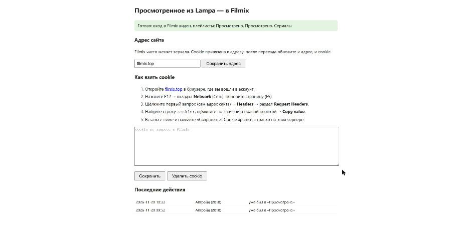

# Просмотренное из Lampa — в плейлисты Filmix (`fx-sync`)

Отметили фильм или сериал просмотренным в Lampa — он сам появляется в плейлисте Filmix и пропадает из закладок Filmix:

- фильм → плейлист «Просмотрено»;
- сериал → плейлист «Просмотрено. Сериалы»;
- в обоих случаях тайтл убирается из «Закладок» Filmix.



## Что считается отметкой «просмотрено»

- **Кнопка MyShows в карточке** (плагин [MyShows](https://github.com/Igorek1986/lampa-plugins)): статус «Просмотрено» у фильма или у сериала целиком. Отметки отдельных серий ничего не запускают. Если MyShows сам ставит «просмотрено» в конце воспроизведения, это тоже считается.
- **Статус Lampa «Просмотрено»** (`viewed`), если он вам доступен (в штатной Lampa он требует CUB Premium).

Одна и та же карточка, отмеченная обоими способами, отправляется один раз.

Работает только в основном профиле [profiles.js](https://github.com/levende/lampa-plugins): аккаунт Filmix один.

## Как устроено

У Filmix нет API для плейлистов и закладок, поэтому `fx-sync.py` (Python 3, без зависимостей) делает те же запросы, что кнопки сайта, с cookie вашей сессии:

| Действие | Запрос сайта |
|---|---|
| Найти тайтл | `GET /api/v2/suggestions?search_word=…` |
| Какие плейлисты есть и где уже лежит тайтл | `POST /api/playlist/get_list` `movie_id` |
| Добавить в плейлист | `POST /api/playlist/add_item` `id`, `item_id` |
| Убрать из закладок | `GET /engine/ajax/favorites.php?fav_id=…&action=minus` |

- **Без повторов.** В плейлист тайтл добавляется, только если его там ещё нет. Из закладок он только убирается (`action=minus`), а не переключается, как кнопкой на сайте.
- **Поиск.** Тайтл ищется по оригинальному и русскому названию, типу (фильм или сериал) и году ±1. Если подходящих несколько или ни одного, Lampa показывает список кандидатов и пункт «Пропустить». Выбор запоминается для этой карточки TMDB.
- **Частота.** На частые запросы Filmix отвечает `503`, поэтому сервис шлёт не чаще одного запроса в 1,5 секунды и один раз повторяет запрос после `503`.
- **Очередь.** Если сервис или Filmix недоступны, или cookie устарела, плагин хранит отметку на устройстве и повторяет её при запуске Lampa и раз в 10 минут.

`fx-sync.js` — плагин Lampa. Он отправляет сервису названия, год и тип и показывает итог уведомлением, например «Filmix: «Дюна» в «Просмотрено», убран из закладок».

### Как плагин узнаёт об отметке MyShows

Плагин MyShows шлёт JSON-RPC `manage.SetMovieStatus` или `manage.SetShowStatus` со `status: "finished"`. `fx-sync.js` и [`kp-vote.js`](../kp-vote/) перехватывают эти запросы (`XMLHttpRequest` и `fetch`) и при успешном ответе рассылают событие Lampa `msbbol_watched` с открытой карточкой:

```js
Lampa.Listener.follow('msbbol_watched', function (e) {
  // e.card — карточка, e.kind — 'movie' | 'tv', e.source — 'myshows'
});
```

Перехват ставится один раз на страницу (`window.msbbol_watched_hook`), сколько бы плагинов его ни содержало. Своим плагинам можно просто подписаться на это событие.

## Установка

Нужен свой сервер в домашней сети, например рядом с Lampac.

1. Положите `fx-sync.py` и `fx-sync.js` в `/opt/fx-sync/`, а `fx-sync.service` — в `/etc/systemd/system/`:

   ```sh
   systemctl daemon-reload
   systemctl enable --now fx-sync
   curl -s localhost:9122/status    # {"configured": false, "loggedIn": false, "host": "filmix.top", ...}
   ```

   Сервис слушает порт `9122` (переменная `PORT`). Cookie, адрес сайта, найденные соответствия и журнал хранятся в `/var/lib/fx-sync/` с правами 0600 (`DynamicUser`, `StateDirectory`).

2. Откройте `http://<сервер>:9122/` на компьютере:
   - проверьте **адрес сайта**: Filmix часто меняет зеркала, а cookie привязана к адресу;
   - вставьте **cookie**: Filmix → F12 → Network → обновить страницу → первый запрос → Headers → Request Headers → `cookie:` → Copy value. Сервис сохранит cookie, только если с ней виден вход в аккаунт.

3. Подключите плагин в Lampa: «Настройки» → «Расширения» → «Добавить плагин», адрес `http://<сервер>:9122/fx-sync.js`.
   Если у вас Lampac, удобнее добавить его в `init.conf` → `LampaWeb.customPlugins`:

   ```json
   { "name": "Filmix: просмотренное", "url": "http://<сервер>:9122/fx-sync.js", "status": 1, "author": "msbbol" }
   ```

В настройках Lampa появится раздел «Filmix: просмотренное»: там состояние, переключатель «Отправлять в Filmix» и число отметок в очереди.

Названия плейлистов меняются переменными `PLAYLIST_MOVIES` и `PLAYLIST_SERIES`, адрес сайта по умолчанию — переменной `FILMIX_HOST`.

## API сервиса

| Запрос | Ответ |
|---|---|
| `GET /status` | `{"configured", "loggedIn", "host", "playlists": [...], "log": [...]}` |
| `POST /watched` `{"kind": "movie", "title": "Дюна", "original_title": "Dune", "year": 2021, "tmdb": 438631}` | `{"status": "done", "filmix": {...}, "playlistAction": "added"\|"already", "favorites": "removed"\|"absent"}`, `{"status": "choose", "candidates": [...]}` или `{"status": "not_found"}` |
| `POST /watched` `{..., "filmix_id": 145261}` | то же, с явно выбранным тайтлом Filmix |
| `POST /cookie` `{"cookie": "..."}` | сохраняет cookie, если с ней виден вход |
| `POST /cookie/delete` | удаляет cookie |
| `POST /host` `{"host": "filmix.top"}` | новый адрес сайта |

## Ограничения

- Поиск Filmix отдаёт немного результатов. Старые фильмы с частыми названиями («Брат», 1997) может не найти, тогда отметьте их на сайте вручную.
- Отметки, сделанные до установки, сами не переносятся.

## Безопасность

- Cookie — ключ к вашему аккаунту Filmix. Сервис хранит её только у себя, наружу не отдаёт и в лог не пишет.
- Запросы принимаются только из локальной сети (частные адреса и localhost). Не публикуйте порт сервиса в интернет.
