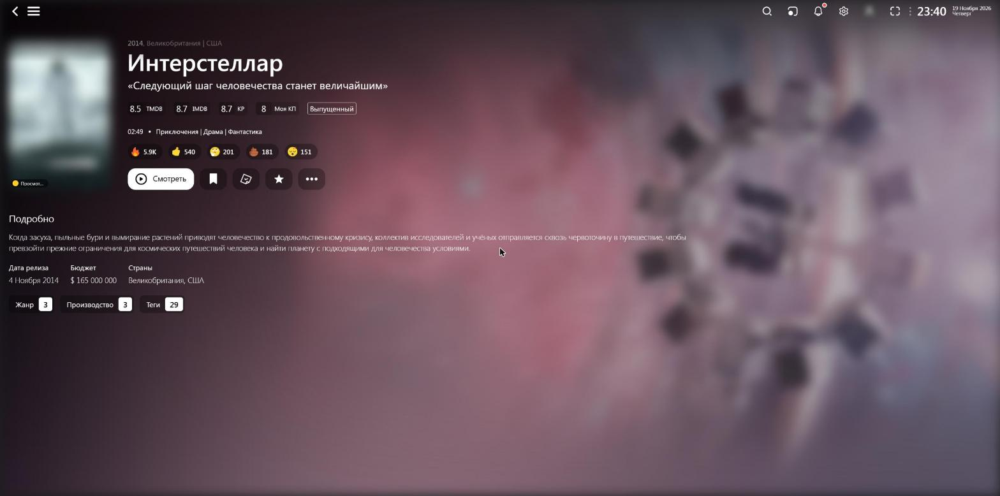
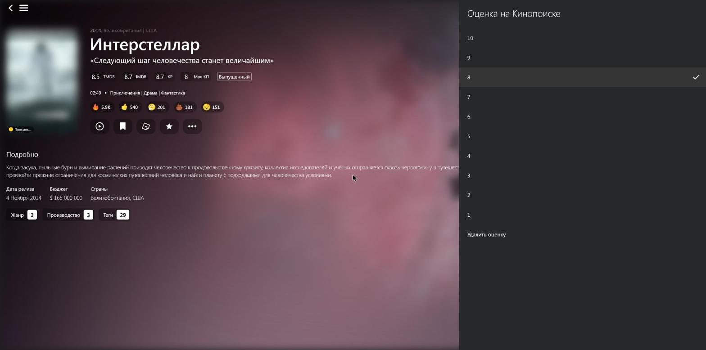
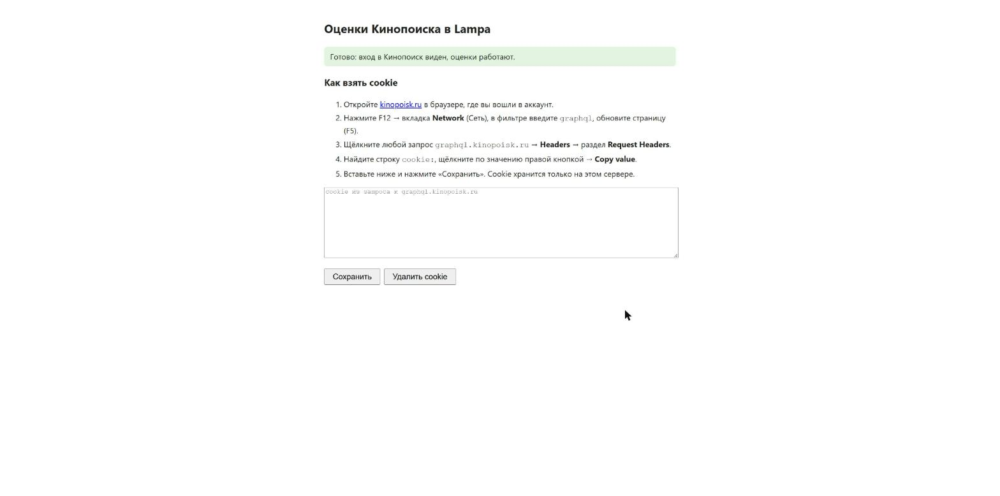

# Оценки Кинопоиска в Lampa — `kp-vote`

Ставьте оценки от 1 до 10 прямо в Lampa, и они уходят в ваш аккаунт Кинопоиска. Ваши оценки с Кинопоиска видны в карточке фильма.





<sub>Постеры и фоны на скриншотах размыты.</sub>

## Что умеет

- **Значок «Моя КП»** в строке рейтингов карточки: ваша оценка с Кинопоиска.
- **Кнопка «Оценить»** (или «Моя оценка: 8») рядом с закладками: список от 10 до 1 и пункт «Удалить оценку». Оценка сразу уходит на Кинопоиск.
- **Оценка при отметке «просмотрено».** Если вы отметили фильм или сериал просмотренным кнопкой [MyShows](https://github.com/Igorek1986/lampa-plugins) в карточке (или статусом Lampa «Просмотрено») и оценки ещё нет, Lampa предложит её поставить. Если MyShows сам ставит «просмотрено» в конце воспроизведения, оценку спросят после закрытия плеера. Отключается в «Настройки» → «Оценки Кинопоиска».
- **Только в основном профиле** [profiles.js](https://github.com/levende/lampa-plugins): оценки уходят в один аккаунт Кинопоиска, поэтому в других профилях кнопки нет.

## Как устроено

У Кинопоиска нет официального API для личных оценок. Сайт kinopoisk.ru ставит и читает их через свой GraphQL (`graphql.kinopoisk.ru`) от имени вошедшего пользователя. Сервер Кинопоиска принимает только свои запросы, причём текст запроса должен совпадать с сайтовым побайтно. Поэтому:

- `kp-vote.py` — небольшой сервис (Python 3, без зависимостей). Он хранит cookie вашей сессии Кинопоиска и отправляет те же запросы, что сайт: `MoviePreviewCard` (прочитать оценку), `MovieSetVote` и `MovieRemoveVote`. Их тексты лежат в `queries.json`.
- `kp-vote.js` — плагин Lampa. Id Кинопоиска для карточки TMDB он берёт у Lampac (`/externalids`), оценку — у сервиса.
- Отметку MyShows плагин видит по его запросам `manage.SetMovieStatus` / `manage.SetShowStatus` со статусом `finished` и рассылает событие Lampa `msbbol_watched`. Этот же перехват есть в [`fx-sync`](../fx-sync/), подробнее — там.

Если Кинопоиск поменяет запросы на сайте, сервис перестанет работать, пока их не снимут заново (DevTools → Network → `graphql`, тексты операций лежат в JS-бандлах сайта).

## Установка

Нужен свой сервер в домашней сети, например рядом с Lampac.

1. Положите `kp-vote.py`, `kp-vote.js` и `queries.json` в `/opt/kp-vote/`, а `kp-vote.service` — в `/etc/systemd/system/`:

   ```sh
   systemctl daemon-reload
   systemctl enable --now kp-vote
   curl -s localhost:9121/status    # {"configured": false, "loggedIn": false}
   ```

   Сервис слушает порт `9121` (переменная `PORT`), cookie хранит в `/var/lib/kp-vote/cookie` с правами 0600 (`DynamicUser`, `StateDirectory`).

2. Откройте `http://<сервер>:9121/` на компьютере и вставьте cookie Кинопоиска. Там же инструкция:
   kinopoisk.ru → F12 → Network → фильтр `graphql` → любой запрос к `graphql.kinopoisk.ru/graphql/?operationName=…` → Headers → Request Headers → `cookie:` → Copy value.
   Сервис сохранит cookie, только если с ней виден вход в аккаунт.

   

3. Подключите плагин в Lampa: «Настройки» → «Расширения» → «Добавить плагин», адрес `http://<сервер>:9121/kp-vote.js`.
   Если у вас Lampac, удобнее добавить его в `init.conf` → `LampaWeb.customPlugins`:

   ```json
   { "name": "Оценки Кинопоиска", "url": "http://<сервер>:9121/kp-vote.js", "status": 1, "author": "msbbol" }
   ```

## API сервиса

| Запрос | Ответ |
|---|---|
| `GET /status` | `{"configured": true, "loggedIn": true}` |
| `GET /vote?kp=258687` | `{"kp": 258687, "value": 8}` (`null`, если оценки нет) |
| `POST /vote` `{"kp": 258687, "rate": 9}` | `{"kp": 258687, "value": 9}`; `rate: 0` удаляет оценку |
| `POST /cookie` `{"cookie": "..."}` | сохраняет cookie, если с ней виден вход |
| `POST /cookie/delete` | удаляет cookie |

## Безопасность

- Cookie — это ключ к вашему аккаунту Яндекса. Сервис хранит её только у себя, наружу не отдаёт и в лог не пишет.
- Запросы принимаются только из локальной сети (частные адреса и localhost). Не публикуйте порт сервиса в интернет.
- Если выйти из аккаунта Кинопоиска, cookie перестанет действовать; в настройках Lampa появится «Cookie устарела».
