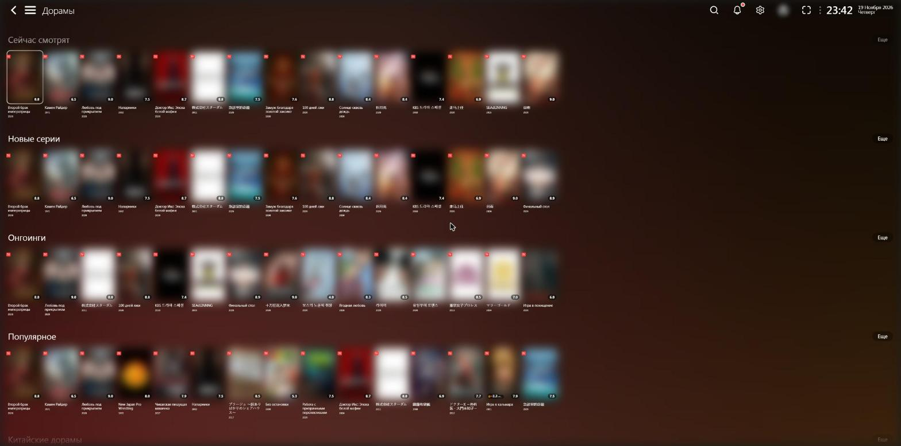

# Доработки Lampac NextGen

Файлы для [Lampac NextGen](https://github.com/lampac-nextgen/lampac) в Docker (`ghcr.io/lampac-nextgen/lampac`). Пути ниже — для установки в `/opt/lampac`.

Lampac подхватывает свои файлы плагинов из папки `plugins/override` внутри контейнера, если там лежит файл с тем же именем. Её удобно подключить с хоста:

```yaml
    volumes:
      - ./plugins-override:/lampac/plugins/override:ro
```

После замены файла перезапустите контейнер: Lampac кеширует плагины в памяти.

## Раздел «Дорамы» — `dorama.js`

Во встроенном плагине Lampac есть раздел «Дорамы» (`init.conf` → `LampaWeb.initPlugins.dorama: true`), но в исходном виде он показывает только корейские дорамы и не работает при включённом входе по аккаунту (`accsdb`). Эта версия:

- **работает с `accsdb`:** добавляет `account_email` и `uid` к запросам `/tmdb/…`; без них Lampac отвечает «Войдите в аккаунт», и раздел пустой;
- **показывает корейские, китайские и японские дорамы** во всех подборках и добавляет подборки «Китайские дорамы» и «Японские дорамы»;
- **убирает лишнее:** аниме, реалити, ток-шоу и новости (`without_genres=16,10764,10767,10763`).



<sub>Постеры на скриншоте размыты.</sub>

Установка: положите `dorama.js` в `/opt/lampac/plugins-override/`, включите `"dorama": true` в `LampaWeb.initPlugins` и перезапустите Lampac.

Файл основан на `Modules/LampaWeb/plugins/dorama.js` из Lampac NextGen и, как и оригинал, распространяется под **AGPL-3.0** (текст — в `LICENSE-AGPL-3.0.txt`). Изменённые места отмечены комментариями `msbbol:`.

## Убрать старые плагины с устройств — `lampainit-invc.js`

Lampac сам добавляет плагины из `customPlugins` на все устройства, но никогда их не удаляет: если убрать плагин из `init.conf`, на уже настроенных устройствах он останется. `lampainit-invc.js` — штатный способ Lampac выполнить свой код при запуске Lampa. Мой вариант при каждом запуске удаляет с устройства плагины, чей адрес совпал со списком `retired`:

- Nightingale (уведомления о новых сериях) — заменён встроенным модулем Lampac SeriesNotify;
- Favorite Plus с адреса автора — заменён исправленной копией с моего сервера (см. [`favorite-plus`](../favorite-plus/)).

Установка: положите файл в `/opt/lampac/plugins-override/` и поправьте список `retired` под себя.

## Уведомления о новых сериях в Telegram — SeriesNotify

Модуль SeriesNotify уже есть в образе Lampac, но выключен в своём `manifest.json`. Включить его можно, не пересобирая образ, — подменой манифеста:

```yaml
    volumes:
      - ./module-overrides/SeriesNotify/manifest.json:/lampac/module/SeriesNotify/manifest.json:ro
```

Сам файл — [`module-overrides/SeriesNotify/manifest.json`](module-overrides/SeriesNotify/manifest.json):

```json
{"enable": true, "dynamic": true, "references": ["references/"], "tree": ["Models", "Controllers", "ModInit.cs"]}
```

Токены бота, TMDB и Lampac задаются в разделе `SeriesNotify` в `init.conf`. Плагин для Lampa — `{localhost}/tg-notify.js`: колокольчик в карточке сериала и раздел «TG Подписки».

## Android-приложение со своим сервером — `Dockerfile.lampac`

В Lampac NextGen есть модуль LampacApk: по адресу `http://<сервер>:9118/lampac.apk` он собирает Android-приложение Lampa с адресом вашего сервера внутри. Для сборки ему нужны Java, `apksigner` и `zipalign`, а в официальном образе их нет — без них вместо APK приходит «Lampac APK build failed: zipalign not found».

`Dockerfile.lampac` добавляет их поверх официального образа:

- `deb.debian.org` у меня отдаёт около 28 КБ/с, поэтому основной репозиторий заменён на белорусское зеркало `ftp.by.debian.org`. Выберите зеркало под свою страну или удалите эту строку;
- в slim-образе нет `/usr/share/man/man1`, без неё OpenJDK не устанавливается.

В `docker-compose.yaml` вместо `image: ghcr.io/lampac-nextgen/lampac:latest`:

```yaml
    image: lampac-apk:latest
    build:
      context: .
      dockerfile: Dockerfile.lampac
      pull: true
```

Обновление Lampac после этого: `docker compose build && docker compose up -d` (сборка сама подтянет свежий официальный образ).

Ключ подписи APK создаётся при первой сборке в `database/lampac-apk/` (`lampac-apk.jks` и `lampac-apk.pass`). Сохраните их: с другим ключом Android не обновит уже установленное приложение.
